# iPhone Duo adaptive layout: visual guide

Bantera 3.30.0 (493). See [implementation and verification notes](iphone-duo-layout.md) for native layout signals, state preservation and testing limitations.

Simulator previews use local sample content, not a live account. The debug fixture toolbar is absent from the installed production app.

Duo navigation follows the native window edge. Screenshots include both Split View placements, both displays, horizontal navigation, tabletop, and large text.

## Duo inner landscape: Practice

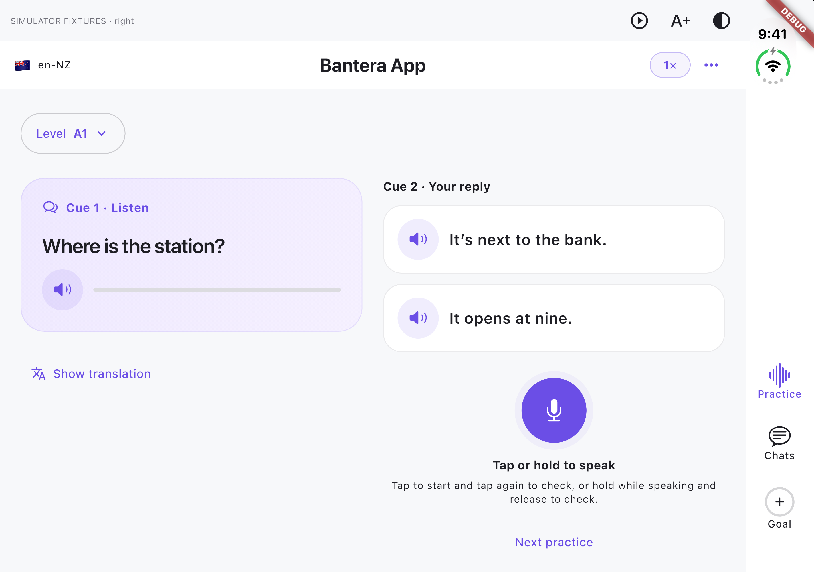

## Duo inner landscape: Chats

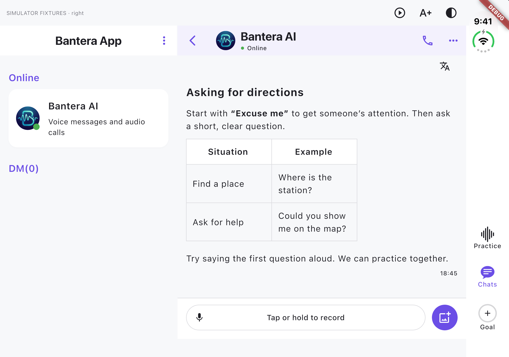

## Duo inner landscape: Goal

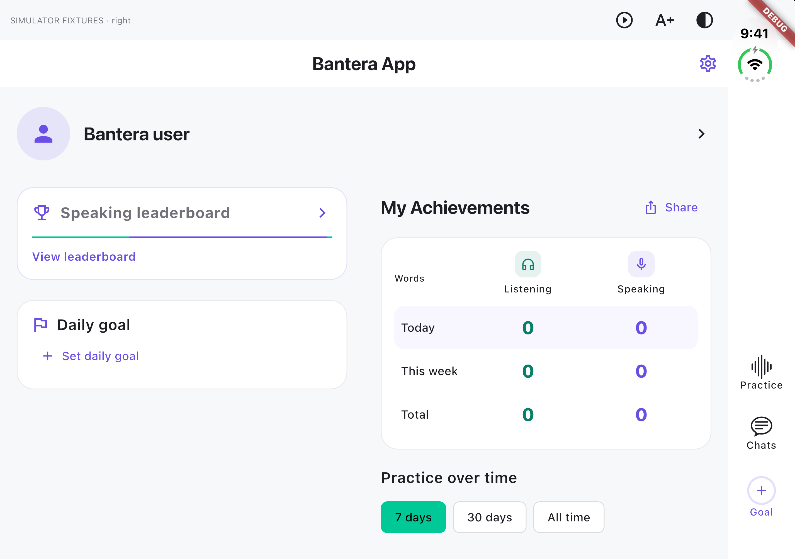

## Duo inner portrait: horizontal tabs

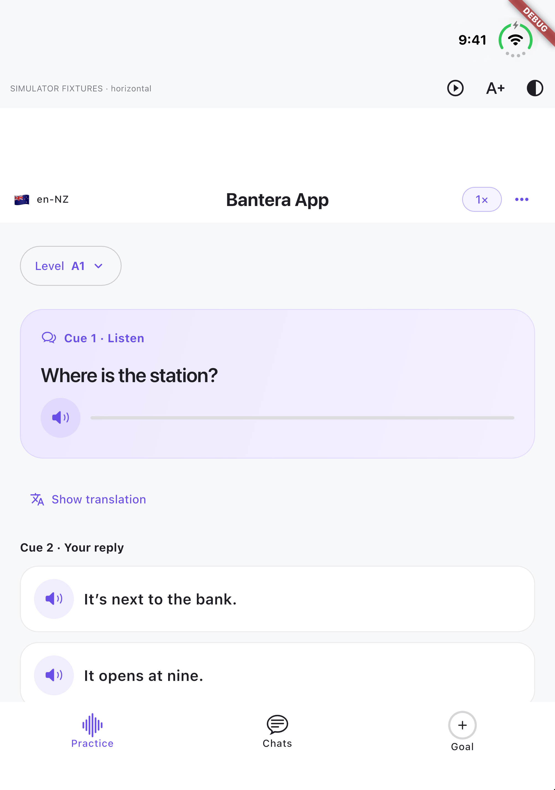

## Duo outer portrait

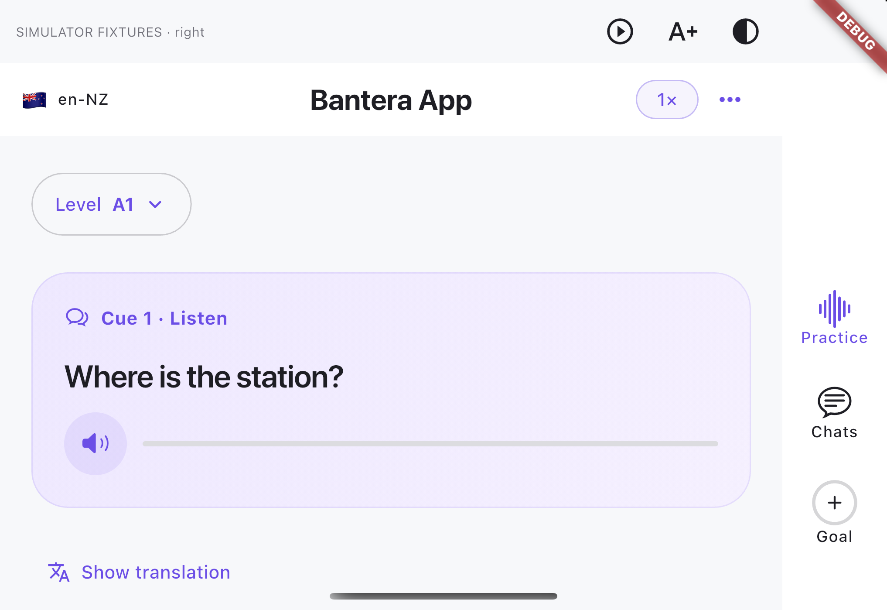

## Duo outer landscape

## Duo Split View: left

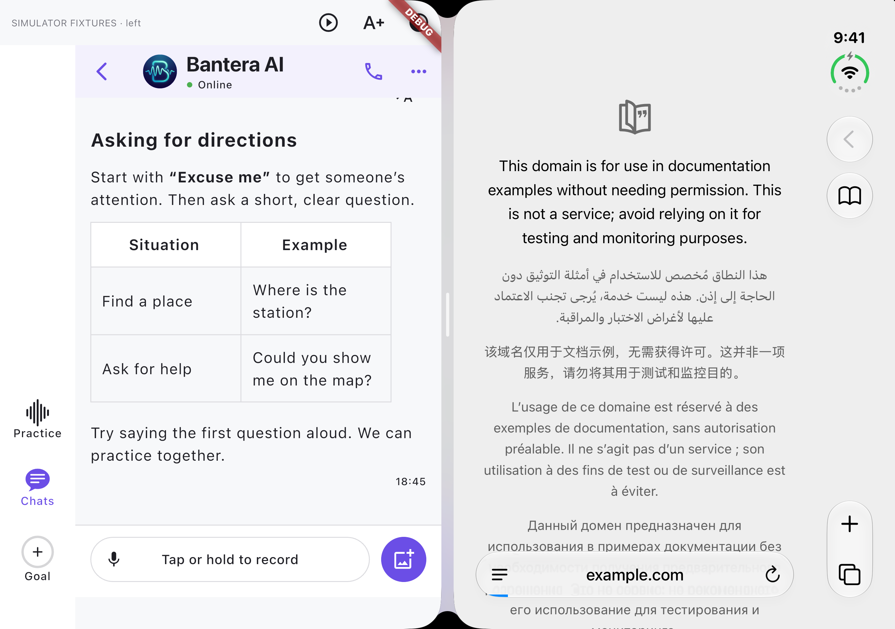

## Duo Split View: right

## Duo dialogue and transcript

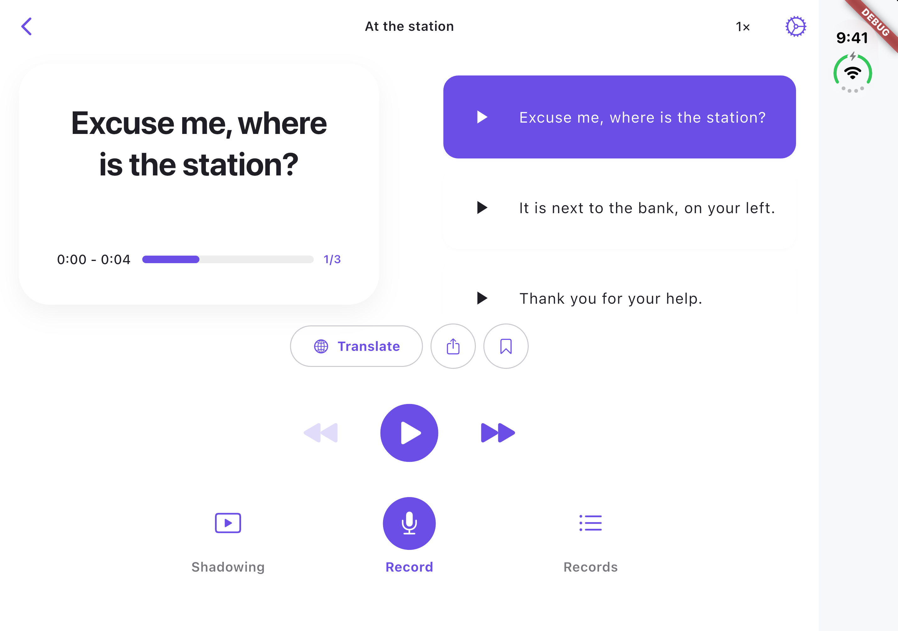

## Duo tabletop

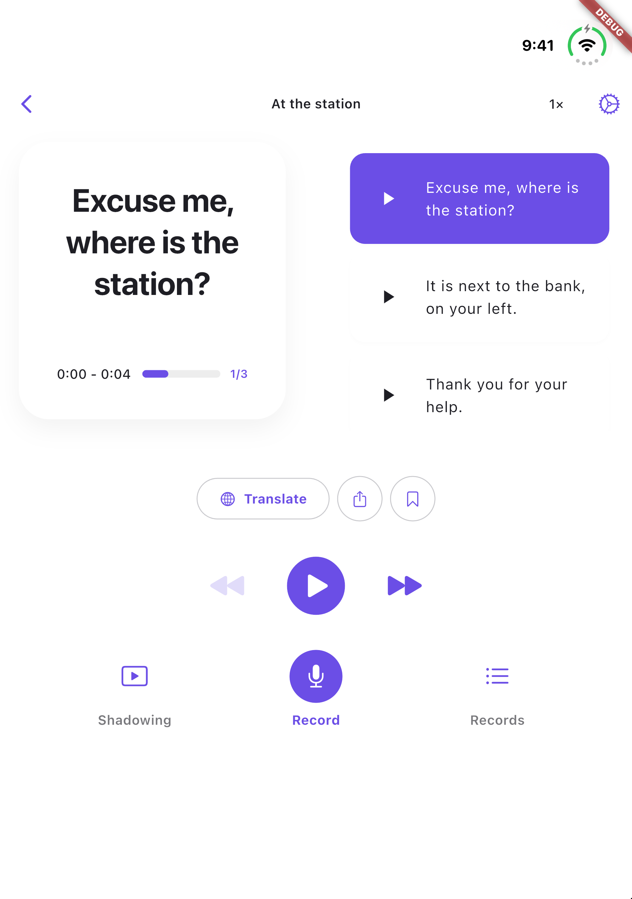

## Duo large text and dark mode

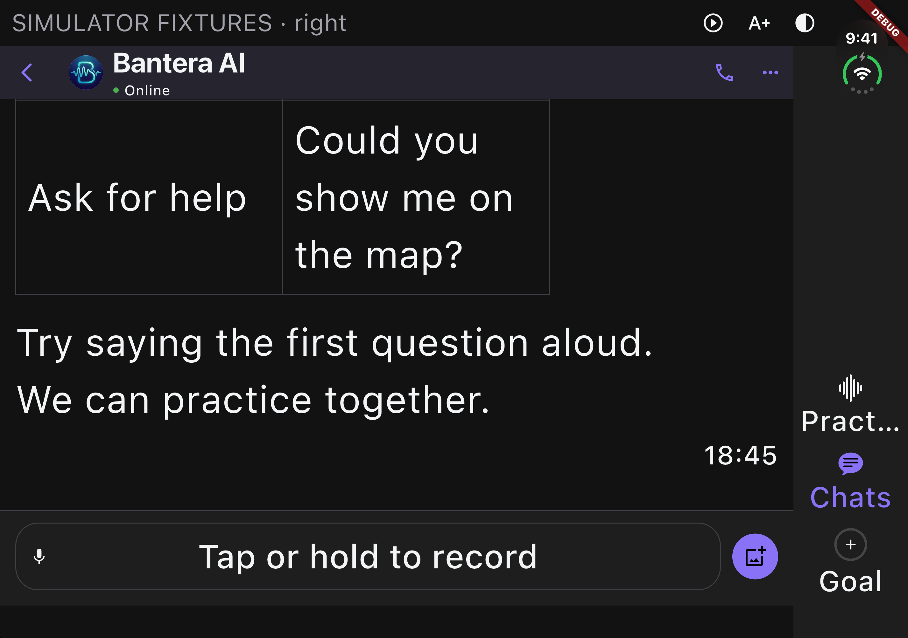

## Ordinary iPhone

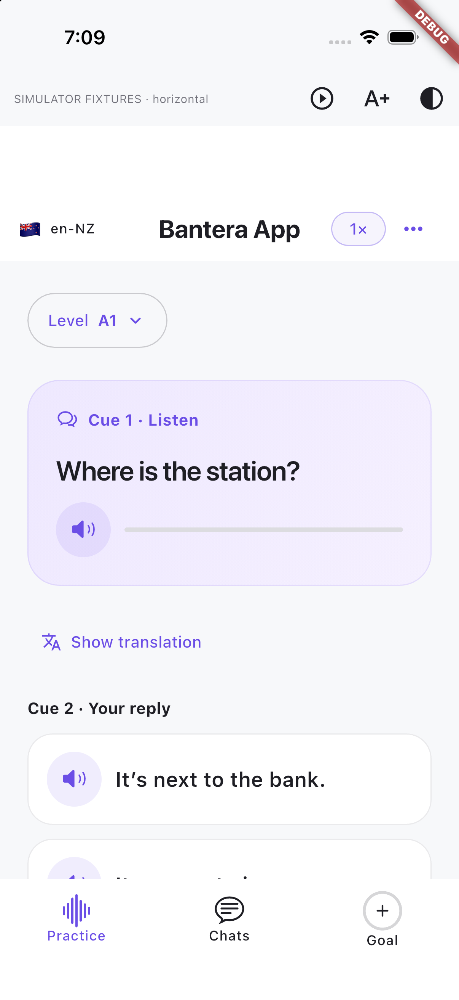

## iPad portrait

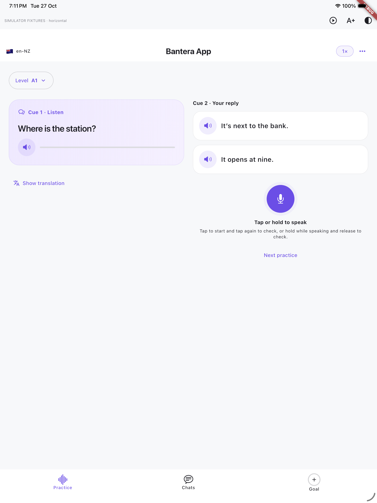

## iPad landscape

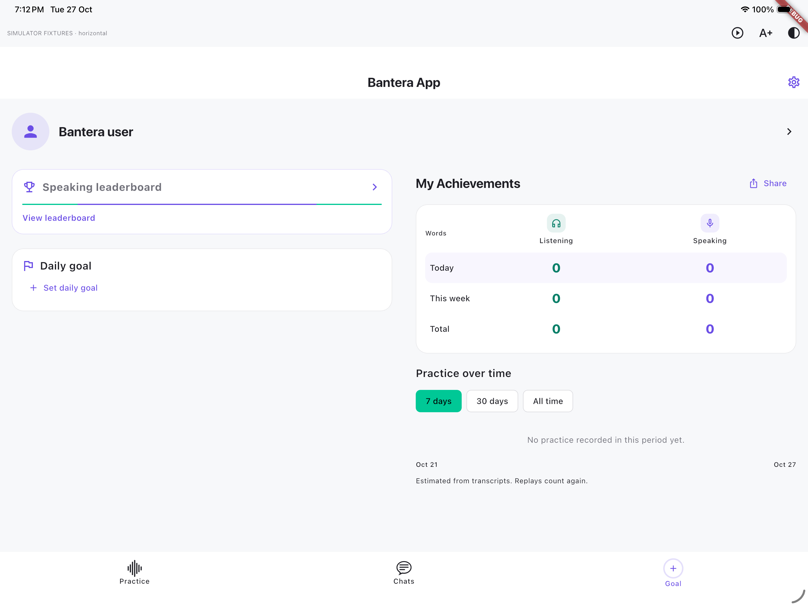
