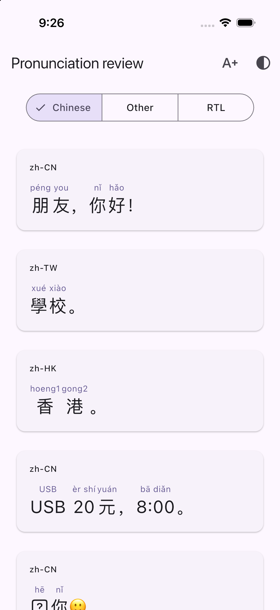
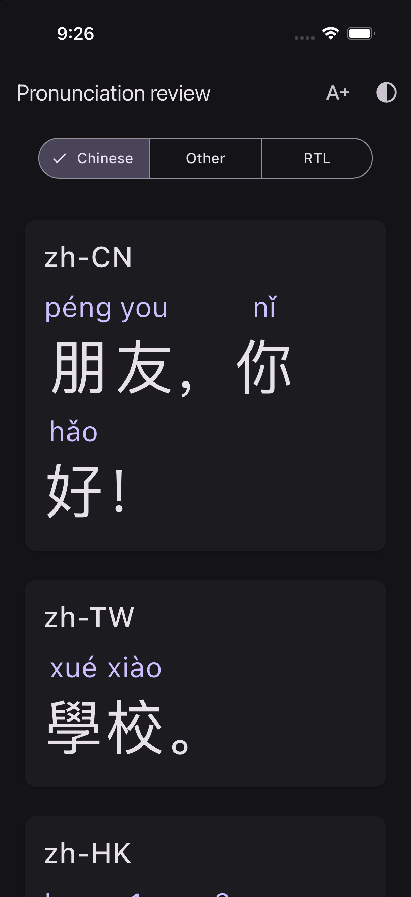
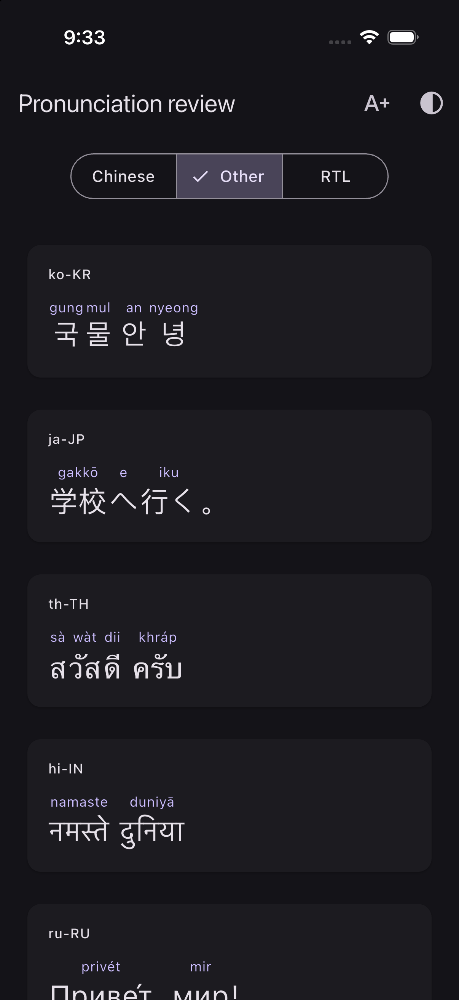
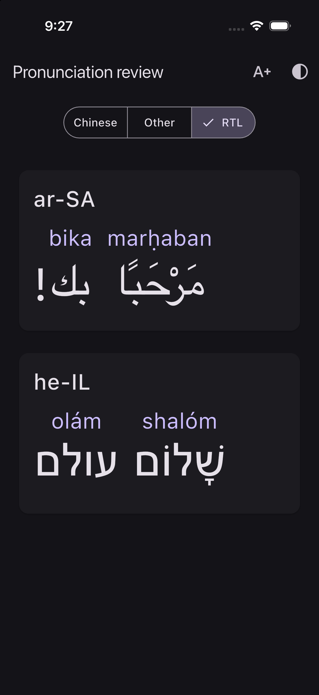
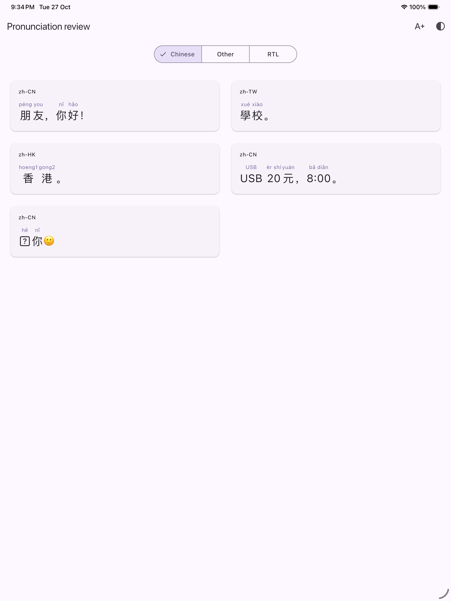
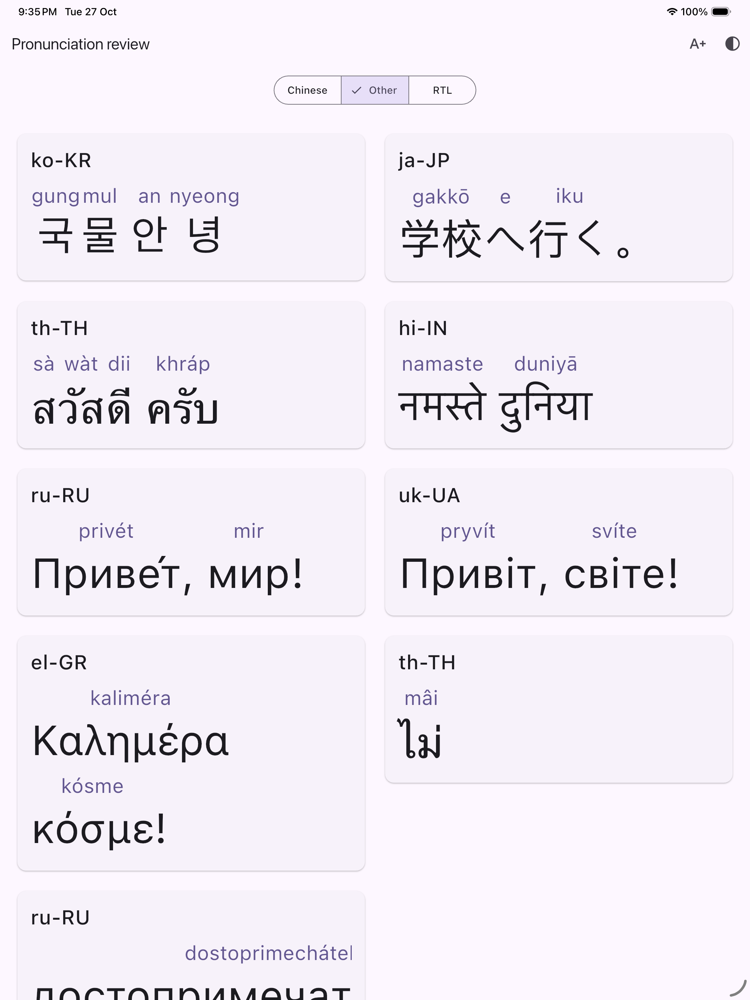

# Pronunciation alignment, app 3.31.0 (498)

The old API accepted phrase-sized mappings, and the renderer let the reading and source wrap separately. Saved `ready` mappings bypassed refresh. The new renderer validates mappings before display and keeps each reading/source pair in one measured unit. Invalid mappings fall back to original text while the controller requests updated data.

Chinese and Cantonese readings sit above individual Han characters, Korean above syllable blocks, Japanese above appropriate groups, Thai above syllables, Hindi above groups/words, and Arabic, Hebrew, Russian, Ukrainian and Greek above whole words. Combining marks stay attached. Numbers/times remain contextual units, separate from adjacent script. The backend never guesses how to split an existing phrase's reading.

Word selection remains separate from alignment: tapping either character in 朋友 can underline the entire word, while péng and you stay above their own characters. A second tap confirms the explanation flow. Long press offers Copy for the exact original sentence, including whitespace/punctuation. Ruby readings are excluded from duplicate accessibility announcements; source units have ordered semantic containers. Existing recording layout freezing prevents background changes from moving a held microphone.

Long units scroll horizontally at the requested text size rather than shrinking or independently wrapping. Punctuation is grouped with neighbouring units. RTL source order is retained, with Latin readings left-to-right above each word. Font coverage remains a platform limitation for rare supplementary Han glyphs; the underlying text is preserved.

The controller rejects stale invalid embedded data, refreshes ready data on activation, validates the response against all three source strings, and persists updated last-practice data. Polling is capped at 24 polls per activation; later activation or explicit retry rechecks without resetting the server's retry budget.

## Verification

- 160 focused Flutter tests passed: alignment fixtures for all 11 language families, regional Chinese variants, punctuation, numeric/mixed script units, decomposed marks, invalid phrases, narrow/large-text geometry, long sentences in wide windows, whole-word selection, original-text copying, repaired cache refresh, long-press stability, callback, CallKit and relevant audio tests.
- Focused static analysis: no issues.
- iOS device debug build without signing passed for `lib/main.dart`; iOS simulator build and installation passed, including the notification service extension.
- iPhone 17 Pro and iPad Pro 13-inch simulators reviewed in light/dark mode and 2.3× text. Following separate installation authorization, the release build was signed and installed as 3.31.0 (498) on the connected iPhone 17 Pro. Installed metadata was verified; the app was not launched or tested on the phone.
- This is structural/visual verification, not a claim that every generated pronunciation is phonetically correct. Japanese/Thai linguistic grouping still depends on generation; validation rejects common broad/malformed structures but is not a dictionary or speech evaluator.

## Simulator screenshots

These use the production renderer with deterministic fixtures, not a live account. The review entry point is `tool/pronunciation_alignment_preview.dart`.

## Message notification avatars and CallKit

`BanteraNotificationService` is an iOS 15+ notification service extension. It creates an incoming `INSendMessageIntent` with the sender's profile photo from the existing public Bantera avatar endpoint. It only processes message payloads with sender metadata, limits download time, downsamples the photo, and falls back to the original alert when the image/intent is unavailable. Backend fields and `mutable-content` are additive; older clients retain their original notification behavior. VoIP payloads do not opt into this path.

Communication Notifications is enabled for Runner and `bantera.lisenhuang.com.NotificationService` in Lisen Huang's team (`HPL74FCW8E`). Development profiles named `Bantera Development Communication 20261027` and `Bantera Notification Service Development 20261027` were generated for the connected iPhone and existing Apple Development certificate. The release bundle and both extensions passed signing verification and device installation. App Store distribution profiles still need regeneration before a future store release. APNs delivery and system avatar presentation remain unverified on the physical phone; the user will check those.

CallKit's `CXCallUpdate` does not expose a per-caller avatar. `CXProviderConfiguration.iconTemplateImageData` is the app's template icon, not a caller-photo slot. We have not replaced that app icon or changed incoming-call handling. iOS may use a contact photo when it can resolve the caller through Contacts.

Apple references: [communication notifications](https://developer.apple.com/documentation/usernotifications/implementing-communication-notifications), [CXCallUpdate](https://developer.apple.com/documentation/callkit/cxcallupdate), [provider icon](https://developer.apple.com/documentation/callkit/cxproviderconfiguration/icontemplateimagedata).
